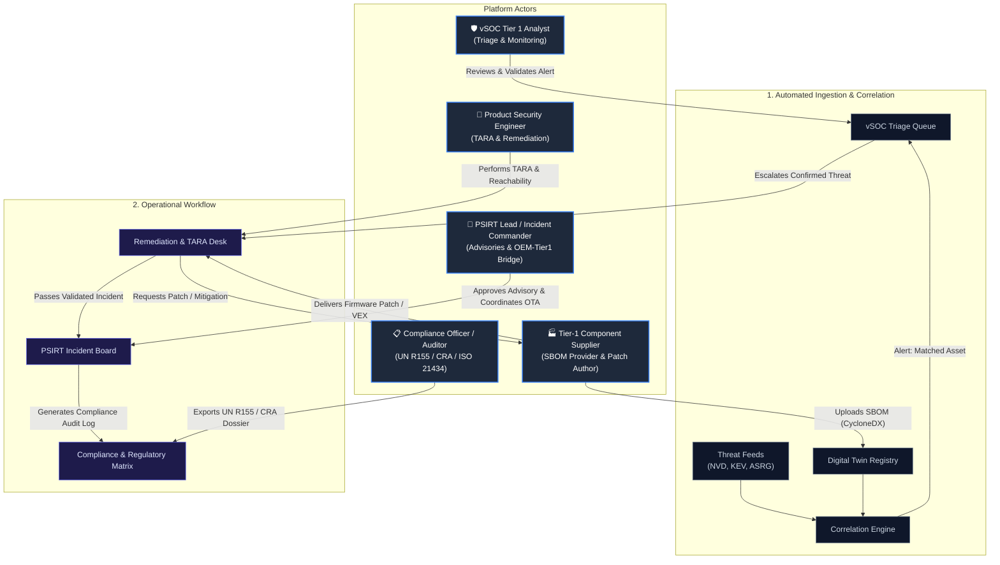
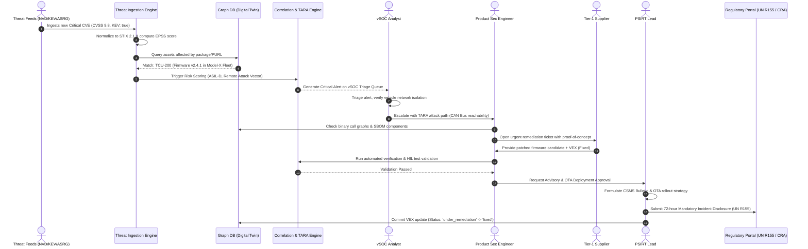
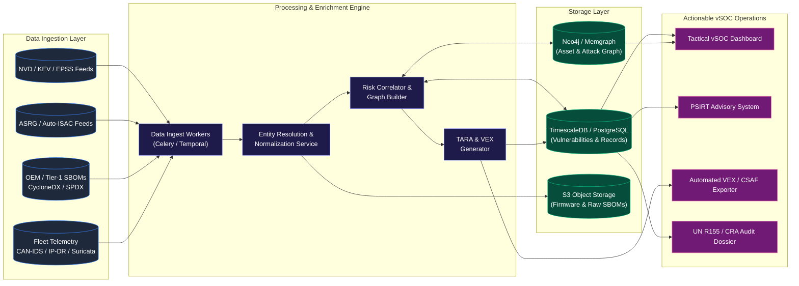

Next-Gen vSOC (Vehicle & Product Security Operations Center) Master Architecture & Implementation Blueprint

---

1. Executive Vision: vSOC vs. DestroSolutions Benchmark

Based on the reverse engineering of DestroSolutions PSOC (from the 235 routes and 19,200+ feature nodes in your crawl data), Destro was built as an early prototype for Product Security Operations (spanning automotive ECUs like `p-ivi-700`, `p-tcu-200`, `p-bms-050`, `p-evse-310`), but had several critical shortcomings:

1. Unimplemented / Errored Modules: Destro completely failed on 64 critical operational routes—including PSIRT Operations, Collaboration & Advisories, Remediation Workflows, Watchlists, Ingestion Health/Sources, Supplier Management, and Verification Records/Test Plans.
2. AI Chatbot Over-Reliance: It leaned on an omnipresent assistant ("Friday") embedded in every navigation bar, obscuring the core analytical capabilities expected by Tier-1 and OEM product security engineers.
3. Static Threat Intel: Their threat intel was presented as rigid cards without a dynamic ingestion graph or automated multi-tier ECU SBOM cross-referencing.

What We Are Building: A Mission-Critical vSOC
We are stripping out the chatbot completely to build a deterministic, analyst-first, high-throughput Vehicle Security Operations Center (vSOC) compliant with UN R155 / UN R156, ISO/SAE 21434, and EU CRA (Cyber Resilience Act).

```
+-------------------------------------------------------------------------------------------------------+
|                                    NEXT-GEN vSOC PLATFORM                                            |
|                                                                                                       |
|  [Module 1: Fleet & Digital Twin]    [Module 2: Threat Intel Engine]   [Module 3: Vulnerability & VEX]|
|  Vehicles, ECUs, Firmware, SBOMs      Multi-source Real-time Ingestion    NVD/EPSS/KEV -> ECU Matching |
|                                                                                                       |
|  [Module 4: TARA Risk Engine]        [Module 5: PSIRT & Incident Desk] [Module 6: Compliance Matrix] |
|  ISO 21434 Threat Trees, CAL/ASIL    UN R155 72h SLA, Tier-1 Portal     EU CRA, ENISA, UN R156 SUMS   |
+-------------------------------------------------------------------------------------------------------+
```

---

2. The Heart of All: Comprehensive Threat Intel Ingestion Engine

To make the vSOC truly alive, the Threat Intelligence engine needs reliable, structured data feeds. Automotive and embedded cybersecurity requires broad coverage beyond standard enterprise IT feeds: Automotive-specific threats (CAN/UDS/CAN-FD, telematics, EV chargers), embedded RTOS vulnerabilities (QNX, FreeRTOS, Zephyr, Yocto), and supply chain zero-days.

2.1 Complete List of Sources to Fetch Threat Intel

| Category | Source Name | Protocol / Format | Update Cadence | Purpose & Target Domain |
| :--- | :--- | :--- | :--- | :--- |
| National & Global CVEs | NVD (NIST CVE 2.0 API) | REST API (JSON) | Every 1-2 hours | Baseline CVEs, CVSS v3.1/v4 scores, CPE product mappings. |
| Exploitation Likelihood | FIRST EPSS API | REST API (JSON / CSV) | Daily (00:00 UTC) | Probability (0.0 - 1.0) of a CVE being exploited in the wild within 30 days. |
| Active Exploitation | CISA KEV (Known Exploited Vulnerabilities) | Public JSON / RSS | Hourly | Mandatory priority triage; zero-tolerance items for fleet safety. |
| Open Source Vulnerabilities | OSV.dev & GitHub Advisory (GHSA) | REST API / GraphQL | Real-time / Hourly | C/C++, Rust, Go, Python open-source dependencies in vehicle software stacks. |
| Automotive Community | ASRG (Auto Threat Intelligence / Auto-ISAC) | STIX 2.1 / TAXII / Feeds | Hourly / Event-driven | Vehicle-specific attack vectors, keyless entry relay attacks, CAN injection, telematics hacks. |
| Embedded & RTOS Advisories | BlackBerry QNX, Zephyr, FreeRTOS, Wind River | Vendor Security Bulletins (CSAF/JSON) | Daily | Core RTOS running in instrument clusters, gateway ECUs, and powertrain ECUs. |
| Automotive Linux Platforms | AGL (Automotive Grade Linux), Yocto Security, Poky | Git / Bugzilla Feeds / CSAF | Daily | Infotainment (IVI), central compute, and smart cockpit stacks. |
| Mobile & Connected Stacks | Android Automotive OS (AAOS) Security Bulletins | Scraping / CSAF feed | Monthly / On-release | Modern IVI systems running AAOS / GAS. |
| EV & Infrastructure (EVSE) | CISA ICS-CERT Advisories | CSAF 2.0 / RSS / JSON | Daily | EV charging stations, ISO 15118 (Plug & Charge), OCPP protocol vulnerabilities. |
| Exploit Intelligence | Exploit-DB & Metasploit Framework Modules | Git / API | Every 6 hours | Verification if proof-of-concept (PoC) or weaponized exploit exists for a CVE. |
| Industrial / Hardware & Chips | NXP, Infineon, Renesas, TI, STMicro Advisories | RSS / Secure Vendor Portals | Daily | Hardware flaws, bootloader bypasses, secure element / HSM vulnerabilities. |
| Threat Actor Tracking | MITRE ATT&CK for Enterprise & ICS | STIX 2.1 JSON | Weekly | Mapping actors (e.g., Volt Typhoon, LockBit, FIN7) to tactics, techniques, and procedures (TTPs). |
| Open Threat Exchange | AlienVault OTX & MISP Communities | STIX 2.0 / REST API | Real-time | IoCs (malicious IPs targeting telematics endpoints, C2 domains). |

2.2 Threat Ingestion & Correlation Architecture
The ingestion engine normalizes all feeds into STIX 2.1 and maps them directly against the Product Asset Graph (Digital Twin).

```
[ External Feeds ]
 - NVD / CISA KEV / EPSS
 - ASRG / Auto-ISAC
 - QNX / Yocto / Zephyr
 - ICS-CERT / Exploit-DB
         │
         ▼
[ Ingestion & Normalizer Workers ]
 ├── Parser & De-duplication (STIX 2.1)
 ├── CPE & Package Normalizer (PURL)
 └── CVSS v4.0 & EPSS Enricher
         │
         ▼
[ Correlation Engine ] ◄────────── [ Vehicle Asset Database ]
 ├── Match CVE -> Component SBOM            ├── Vehicle Models & Trims
 ├── Match PURL -> ECU Firmware             ├── ECUs (IVI, TCU, BMS, ADAS)
 └── Check Reachability / Call Graph         └── CycloneDX / SPDX SBOMs
         │
         ▼
[ Real-Time Priority Alert Engine ]
 ├── High Priority: KEV=True OR EPSS > 0.35 OR Safety Critical (ASIL-D)
 ├── Automated VEX Generation (CSAF 2.0 / OpenVEX)
 └── Notification to PSIRT Queue
```

---

3. Actor Diagram and Integrated User Flow

The platform serves five core personas working together on vehicle security operations. Below is the Actor Hierarchy combined with the Operational User Flow.

Actor Hierarchy & Flow Diagram



---

4. End-to-End Sequence Diagram

This sequence details the lifecycle from a zero-day vulnerability being ingested to fleet remediation, VEX publication, and 72-hour UN R155 incident reporting.



---

5. End-to-End Data Flow Diagram (DFD)



---

6. Complete Technology Stack Section

To achieve real-time responsiveness, complex graph-based dependency mapping, and regulatory compliance, the stack is divided into distinct, purpose-built layers:

```
+──────────────────────────────────────────────────────────────────────────────────+
|                                    FRONTEND                                      |
|  React 19 / TypeScript / Vite / Tailwind CSS / shadcn/ui                         |
|  Data Viz: React Flow / @xyflow/react (Attack Graphs) / Recharts / TanStack Table |
+──────────────────────────────────────────────────────────────────────────────────+
                                         │ REST / WebSocket / SSE
                                         ▼
+──────────────────────────────────────────────────────────────────────────────────+
|                                  BACKEND & API                                   |
|  Node.js (Fastify) or Go / Python (FastAPI for ML & TARA calculation)           |
|  gRPC for inter-service communication / OpenAPI 3.1 Specs                        |
+──────────────────────────────────────────────────────────────────────────────────+
                                         │
        ┌────────────────────────────────┼────────────────────────────────┐
        ▼                                ▼                                ▼
+─────────────────────+  +──────────────────────────────+  +──────────────────────+
|  INGESTION & QUEUES |  |       PRIMARY STORAGE        |  |     GRAPH & SEARCH   |
|  Temporal.io        |  |  PostgreSQL 16 (TimescaleDB) |  |  Neo4j / Memgraph    |
|  (Workflows)        |  |  Structured records, audit   |  |  SBOM & Attack Graph |
|  Redis / Dragonfly  |  |  S3 / MinIO (Object Storage) |  |  Typesense / Meilisearch|
|  PubSub / Celery    |  |  Raw SBOMs, Firmware Binaries|  |  Sub-millisecond CVE |
+─────────────────────+  +──────────────────────────────+  +──────────────────────+
```

Detailed Stack Breakdown

1. Frontend Layer
- Framework: React 19 + TypeScript + Vite.
- UI Architecture: Tailwind CSS + shadcn/ui for consistent data density.
- Threat Graph & Visualizations: 
  - `@xyflow/react` (React Flow) for interactive vehicle network topologies and attack trees.
  - `@visx` / Recharts for temporal threat pulse, EPSS distribution, and CVE metrics.
  - `@tanstack/react-table` for high-performance server-side virtualized tables (supporting 50,000+ CVEs without browser lag).

2. Backend & Microservices
- Core API Gateway: Fastify (Node.js/TypeScript) for low-latency JSON serialization and strict schema validation.
- TARA / Analytics Engine: Python (FastAPI + Pydantic v2) for computing ISO 21434 threat models, attack feasibility ratings, and VEX logic.
- Ingestion & Automation Engine: Temporal.io or Celery to orchestrate scheduled polling, error backoff, and stateful multi-step feed pipelines.

3. Databases & Persistence
- Relational & Time-Series DB: PostgreSQL 16 with TimescaleDB. Handles relational data (users, organizations, products, PSIRT advisories, compliance requirements) and time-series telemetry (feed health metrics, fleet anomaly rates).
- Graph Database: Neo4j or Memgraph. Powers the Digital Twin relationships:
  - `(Vehicle)-[:CONTAINS]->(ECU)-[:RUNS]->(Firmware)-[:CONTAINS]->(Component)-[:HAS_VULN]->(CVE)`
  - Enables instant sub-second blast-radius queries: "If CVE-2024-XXXX is exploited, which vehicles in what trims are vulnerable?"
- Search & Filter Engine: Typesense or Meilisearch for instant, typo-tolerant search across millions of CVEs, KEV items, products, and supplier advisories.
- Object Storage: S3-compatible storage (MinIO / Cloudflare R2) for raw CycloneDX/SPDX SBOM files, CSAF advisories, and firmware binary extracts.

---

7. Core Modules: Surpassing Destro & Solving the Broken Features

Destro failed on 64 distinct paths. Here is how our architecture solves every missing or broken capability:

1. Product Security Digital Twin (`/products`)
Destro threw an error on `/products`, `/products/firmware`, and all supplier links.
- Vehicle Hierarchy: Model Year -> Vehicle Variant (Trim) -> Domain (Infotainment, ADAS, Powertrain, Chassis, Body) -> ECU (Electronic Control Unit) -> Microcontroller/SoC -> Firmware Revision -> SBOM.
- Multi-Format Ingestion: Native upload and parsing of CycloneDX (v1.4, v1.5, v1.6), SPDX (v2.3, v3.0), and binary software bill of materials (via syft / cve-bin-tool).
- Firmware Binary Inspection: Static extraction of hardcoded keys, expired certificates, and unstripped symbols.

2. Threat Intelligence Center (`/threat-intel`)
Destro had broken Watchlists (`?tab=watchlists`) and broken Ingest (`?tab=ingest`).
- Live Feed Health Monitor: Status dashboard monitoring uptime, sync frequency, failure rates, and rate limits for all 13+ feeds listed in Section 2.
- Configurable Watchlists: Users create dynamic watchlists by:
  - Component name (e.g., `busybox`, `openssl`, `linux-kernel`, `autosar-classic`)
  - Target protocol (e.g., `UDS`, `SOME/IP`, `DoIP`, `CAN-FD`, `BLE`, `ISO-15118`)
  - Vendor/Supplier (e.g., `Bosch`, `Vector`, `Wind River`, `Continental`)
- Automotive Threat Actor Profiles: Track specific threat groups targeting automotive manufacturers, suppliers, and connected vehicle infrastructure, mapped to MITRE ATT&CK for ICS and Enterprise.

3. Vulnerability & VEX Engine (`/vulnerabilities`)
Destro errored on `/vulnerabilities?tab=remediation` and filtered KEV queries.
- Auto-VEX (Vulnerability Exploitability eXchange): Automatic determination of exploitability status under CSAF 2.0 / OpenVEX:
  - `not_affected`: Component present, but vulnerable function not compiled, sandboxed, or unreachable from external interfaces (CAN, cellular, Wi-Fi).
  - `affected`: Exposed and vulnerable; immediately triggers PSIRT ticket.
  - `fixed`: Patch verified in test firmware.
  - `under_investigation`: Default state upon ingestion.
- Automated Justification Engine: Generates ISO/SAE 21434 justifications for auditor sign-off when marking an issue "Not Affected".

4. PSIRT Operations & Incident Management (`/psirt`)
Destro completely errored on all PSIRT tabs: Operations, Collaboration, and Advisories.
- Incident Workbench: Triage tickets linked directly to affected ECUs, CVEs, and affected VIN ranges.
- Supplier Collaboration Portal: Secure external token-authenticated portal where Tier-1 suppliers can:
  - Review flagged components.
  - Upload mitigation statements and patched SBOMs.
  - Sign off on joint risk assessments.
- Advisory Publisher: One-click generation of machine-readable CSAF 2.0 and OpenVEX advisories for downstream OEM customers and regulatory authorities.

5. Compliance & Regulatory Matrix (`/compliance`)
- UN R155 (CSMS): Full audit trail tracking vulnerability detection, risk mitigation, and continuous monitoring requirements (Sections 7.2 and 7.3).
- UN R156 (SUMS): Software Update Management System compliance, tracking firmware version authenticity and rollback safety.
- ISO/SAE 21434: Clause-by-clause mapping of Cybersecurity Assurance Levels (CAL 1-4) and TARA documentation.
- EU CRA (Cyber Resilience Act): Articles 11 & 13 reporting readiness (24h early warning / 72h detailed notification).

---

8. Step-by-Step Implementation Roadmap

```
Phase 1: Ingestion Pipeline & Threat Engine
         │
         ▼
Phase 2: Digital Twin (ECUs, Products, SBOMs)
         │
         ▼
Phase 3: Correlation, Graph Matching & TARA
         │
         ▼
Phase 4: PSIRT Desk, Supplier Portal & VEX
         │
         ▼
Phase 5: Compliance Matrix (UN R155 / CRA) & Hardening
```

Phase 1: Foundation & Threat Intel Ingestion Engine (Weeks 1–3)
- [ ] Initialize PostgreSQL with TimescaleDB extension and Neo4j graph instance.
- [ ] Implement Temporal.io background worker pool.
- [ ] Build connectors for NVD API 2.0, CISA KEV JSON, FIRST EPSS API, and OSV.dev.
- [ ] Implement STIX 2.1 data normalizer and deduplication cache in Redis.
- [ ] Build the Threat Intel Center UI: Threat Pulse, Feeds Health monitor, and Live Ingest logs.

Phase 2: Product Security Digital Twin & SBOM Registry (Weeks 4–5)
- [ ] Build Product & ECU hierarchy models (Vehicle -> ECU -> Firmware -> Components).
- [ ] Implement CycloneDX and SPDX parsers (extracting package name, version, PURL, CPE, licenses).
- [ ] Store components in Neo4j graph nodes and connect them to their parent ECUs.
- [ ] Build the Product Catalog UI (`/products`) with filtering by domain, safety integrity level (ASIL A-D), and supplier.

Phase 3: Correlation Engine & Vulnerability Desk (Weeks 6–7)
- [ ] Build automated matching worker: compare newly ingested CVEs against the Neo4j component graph via PURL/CPE.
- [ ] Integrate EPSS and KEV scoring to calculate real-world exploit probability.
- [ ] Create the Vulnerabilities Workbench with server-side virtualized pagination, KEV badges, and component filters.
- [ ] Build the interactive Attack Path & Blast Radius Graph using React Flow.

Phase 4: PSIRT Operations, VEX Generator & Supplier Portal (Weeks 8–9)
- [ ] Implement the complete PSIRT Incident Management state machine (`Triage -> Investigation -> Remediation -> Verification -> Disclosure`).
- [ ] Build the OpenVEX / CSAF 2.0 generator (supporting `not_affected` justifications).
- [ ] Build the Tier-1 Supplier Collaboration Portal with role-based access for external vendors.
- [ ] Enable automated Jira / GitHub issue syncing via bi-directional webhooks.

Phase 5: Regulatory Compliance & Production Launch (Weeks 10–12)
- [ ] Implement compliance matrices for UN R155, UN R156, ISO/SAE 21434, and EU CRA.
- [ ] Build one-click audit report export (PDF / JSON audit trail).
- [ ] Connect fleet telemetry ingestion (CAN-IDS anomaly logs, telematics IP-DR).
- [ ] End-to-end security audit, RBAC enforcement, and production deployment.

---

This architectural plan gives you a clear, enterprise-grade roadmap to build a purpose-designed vSOC. When you're ready to proceed, we can start with the database schemas and the real-time Threat Ingestion Engine.