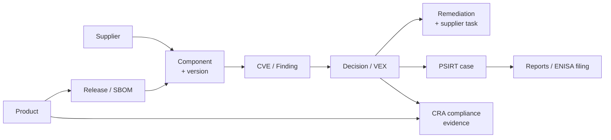

---
tags:
  - overview
---

# PLANNING OVERVIEW — DestroSolutions PSOC

> One page with everything the crawl found. Read this first. For the full detail behind any line, walk the tree from [[START HERE]].

## 1. What the app is

**Product Security OS (PSOC)** at `app.destrosolutions.com`. It lets a manufacturer of connected/automotive products:

1. **Register products** and their software (SBOMs, scans)
2. **Find vulnerabilities** in that software (CVE matching, KEV/EPSS risk)
3. **Decide** what each vulnerability means (VEX: affected / not affected / fixed)
4. **Fix and respond** (remediation plans, supplier tasks, PSIRT cases)
5. **Prove compliance** with the EU Cyber Resilience Act (CRA) and report to ENISA

An AI assistant, **Friday**, is available on every page.

## 2. The numbers

| | Count |
|---|---|
| Modules (sidebar sections) | 11 + 3 hidden pages |
| Page types | 59 (from 211 crawled URLs) |
| Products | 4 main (TCU-200, EVSE-310, IVI-700, BMS-050) + 5 ENISA demo products |
| Components with CVEs | 15 |
| Suppliers | 12 crawled (the graph says 14) |
| Open CVEs / findings | 20 CVEs · 59 findings · 6 known exploited (KEV) |
| User roles | Admin · Analyst · Viewer |

## 3. Modules at a glance

✅ = captured well · ⚠ = partly captured · ❌ = page loaded but nothing captured

| # | Module | What it does | Key actions | Crawl |
|---|---|---|---|---|
| 1 | **Home** | Daily greeting + "what needs my attention" | Ask Friday | ❌ |
| 2 | **Products** | Product list → one product with 8 tabs: Overview, Product design, Software, Vulnerabilities, Decisions, Field, Releases, Compliance | Register product · Upload SBOM · Add scan · Edit details · Export | ✅ |
| 3 | **Friday** (AI) | Chat, inbox, projects, multi-step plans with human approval | Ask · Do it · Attach file | ⚠ only Plans |
| 4 | **Vulnerabilities** | All findings across products, by CVE or by fix, with detail drawer (TL;DR, does this affect me, how to fix) | Filter by severity/KEV/SLA · Import supplier VEX · "Friday, work on it" | ✅ |
| 5 | **Threat intel** | Landscape, actors, graph, watchlists, sources | Search threats to your products | ✅ |
| 6 | **PSIRT** | Incident response: triage board, cases, advisories, playbooks, collaboration | New case · Vulnerability intake · Assignment rules · SLA policies | ✅ |
| 7 | **Supply chain** | Dependency graph (supplier → component → product) + supplier pages | Request SBOM · Notify about a CVE · Register supplier | ⚠ landing page empty |
| 8 | **Compliance** | CRA 9-step wizard, checklist (48 items), classification, gap analysis, document templates, CRA library and tools (SBOM builder, container scan, merge gate, license risk, ENISA SRP) | Generate Evidence Pack · Submit to ENISA · Download report | ✅ (22 pages) |
| 9 | **Reports** | Ready-made reports + scheduled deliveries | Executive summary · KEV exposure · SBOM · VEX export · CRA Art. 14 · Supplier risk | ✅ |
| 10 | **Integrations** | Connect external tools | — | ❌ |
| 11 | **Settings** | Profile, company, team members, MFA, trust portal | Invite member · Set role · Enable MFA | ✅ |
| — | Decision room *(hidden)* | One page per finding to reach a security decision | — | ❌ (15 pages) |
| — | VEX *(hidden)* | All VEX statements across products | New statement · Import supplier VEX | ✅ |
| — | Policies *(hidden)* | Security policies | — | ❌ |

## 4. How the data connects

**In words:** a product has releases, a release has an SBOM listing its components, and components come from suppliers. A component can carry CVEs. Each CVE needs a decision (VEX). The decision leads to a fix and/or a PSIRT case, and these feed the reports and the CRA evidence.

## 5. Main user journeys

1. **Onboard a product:** Products → Register product → Upload SBOM / Add scan → components appear
2. **Triage vulnerabilities:** Vulnerabilities → filter (Critical, KEV, Past SLA) → open finding → Assign owner
3. **Decide and document:** Finding → Decision → VEX statement (draft → review → publish)
4. **Fix:** Product → Remediation → upgrade plan → draft supplier task
5. **Respond to incidents:** PSIRT → New case → playbook → advisory → ENISA submission (24h / 72h / 14d)
6. **Prove compliance:** Compliance → 9-step CRA wizard → checklist → templates → Generate Evidence Pack
7. **Report:** Reports → pick report → export or schedule

## 6. Shared across all pages

- **Sidebar:** Home · Products · Friday · Security (Vulnerabilities, Threat intel, PSIRT, Supply chain, Compliance) · Workspace (Reports, Integrations, Settings)
- **Top bar:** global search (Ctrl K), notifications, dark mode, user menu
- **Friday panel:** chat with suggested questions, file attach, "Ask Friday about this page"
- **Common patterns:** product filter dropdown, Export button, tables with search and pagination, "About…" info tooltips

## 7. Gaps to resolve before planning further

**Not captured (re-crawl with a longer wait):** Home, Friday chat/inbox/projects, Integrations, Policies, Supply chain landing page, Decision room (15 pages), Products › Firmware, Product › Activity, CRA Tools, CRA Articles.

**The demo account returns errors on:** product Requirements, Verification plan, Verification records ("isn't part of the demo dataset"), supplier tasks ("could not be read"), Projects ("couldn't load").

**Open questions for planning:**
- What is the plan for? Rebuilding the app, testing it (test cases per journey), documenting it, or comparing it with competitors?
- Do we need the missing pages above before we start?
- Which journeys from section 5 matter most?

## 8. Where to go next

- Full click-through tree: [[START HERE]]
- Raw lists (spreadsheet): `output/full-crawl/features-by-section.csv`
- Rebuild after a re-crawl: `python scripts/build-vault.py output/full-crawl obsidian-vault`
