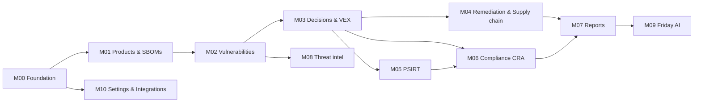

---
tags:
  - plan
---

# REBUILD PLAN — DestroSolutions PSOC

> Module-by-module plan to rebuild the app, based on what the crawl found. Background: [[PLANNING OVERVIEW]] · Full page detail: [[START HERE]]

## How to read this

- Build the modules **in the order below**. Each one depends only on modules above it.
- Each module note has the same parts: **Pages · Features · Data · Depends on · Done when · Unknowns · Size**.
- **Size** is relative (S < M < L < XL), for sequencing rather than for quoting effort.
- ⚠ marks parts the crawl could not see. Confirm those before building them.

## Build order

| Phase | Module | Why at this point | Size |
|---|---|---|---|
| 0 | [[M00 Foundation]] | Login, roles, app shell, shared UI. Every other module needs these | L |
| 1 | [[M01 Products and SBOMs]] | The core data. Nothing else works without products and components | XL |
| 2 | [[M02 Vulnerabilities]] | Matches components to CVEs. This is the product's core value | XL |
| 3 | [[M03 Decisions and VEX]] | Turns findings into decisions | L |
| 4 | [[M04 Remediation and Supply chain]] | Fixes, upgrade plans, suppliers, dependency graph | L |
| 5 | [[M05 PSIRT]] | Incident cases, SLAs, playbooks, advisories | L |
| 6 | [[M06 Compliance CRA]] | CRA wizard, checklist, templates, ENISA reporting | XL |
| 7 | [[M07 Reports]] | Built on data from modules 1–6 | M |
| 8 | [[M08 Threat intel]] | Enrichment layer on top of CVEs | M |
| 9 | [[M09 Friday AI assistant]] | Most useful once there is data to reason over | L |
| 10 | [[M10 Settings Integrations Policies]] | Profile and team come in M00; this module adds the rest | M |

## MVP cut

**MVP = M00 + M01 + M02 + M03, plus two reports from M07 (SBOM and VEX export).**
That delivers the core loop: register a product → upload an SBOM → see its vulnerabilities → record a decision → export it. Everything after that adds depth.

| Release | Modules | Outcome |
|---|---|---|
| **R1 — MVP** | M00 · M01 · M02 · M03 · part of M07 | Core vulnerability management |
| **R2 — Operate** | M04 · M05 · rest of M07 | Fix, respond, report |
| **R3 — Comply** | M06 · M08 | CRA compliance and ENISA reporting, threat context |
| **R4 — Assist** | M09 · M10 | AI assistant, integrations, trust portal |

## Core data model

Every module reads or writes these. M00/M01 set them up first.

| Entity | Key fields seen in the app | Built in |
|---|---|---|
| Organisation | name, logo, website, country | M00 |
| User / Member | name, photo, job title, role (Admin · Analyst · Viewer), status, joined, MFA | M00 |
| Product | name, code (e.g. TCU-200), version, category, sector, CRA class, manufacturer, department, release date, support end, risk score | M01 |
| Release | version, status, SBOM date, support end, component/CVE counts | M01 |
| SBOM source | file, format (CycloneDX/SPDX), hash, date, uploaded by, component count | M01 |
| Component | name, version, type, licence, supplier | M01 |
| Supplier | name, country, registered?, security contact, last response | M01 / M04 |
| CVE | id, description, CVSS, EPSS, KEV flag, fixed-in version | M02 |
| Finding | CVE × component × release, severity, exposure (device / network / cellular), status, owner, SLA due | M02 |
| Decision / VEX statement | finding, status (affected · not affected · fixed · under investigation), justification, state (draft · published), author | M03 |
| Remediation item | upgrade, CVEs cleared, KEV cleared, supplier, owner, supplier task | M04 |
| PSIRT case | id, title, CVEs, severity, owner, SLA due, status, Art. 14 clock | M05 |
| Compliance record | checklist item status, classification answers, gap analysis, evidence, documents | M06 |
| Report | type, scope (products), period, confidentiality, schedule | M07 |

## Recommended tech stack (to confirm)

The crawl shows the UI but not the technology behind it. This is a sensible default:

- **Frontend:** React + TypeScript (Next.js), a component library with data tables, filters and drawers
- **Backend:** TypeScript API (NestJS or similar) or Python (FastAPI), PostgreSQL, background job queue
- **Feeds:** NVD, OSV, CISA KEV, FIRST EPSS, synced on a schedule
- **Standards:** CycloneDX and SPDX for SBOMs, CycloneDX VEX and CSAF for VEX and advisories
- **AI (Friday):** Claude API with tool use over the app's own API

## Before starting

1. Re-crawl the pages the crawl missed (see each module's **Unknowns**), or get screenshots of them
2. Pick the tech stack
3. Agree the MVP scope above
